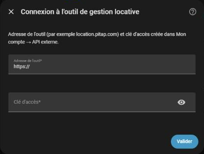
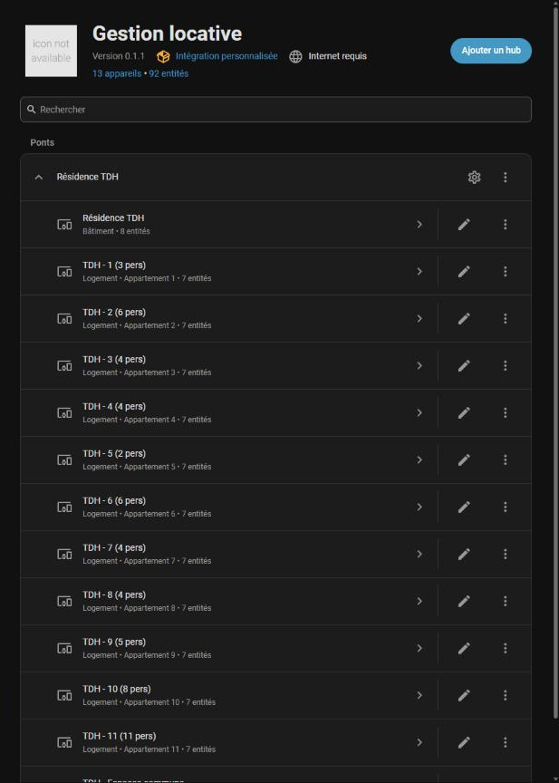
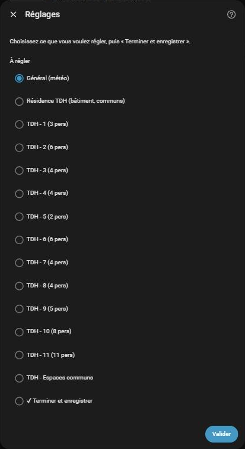
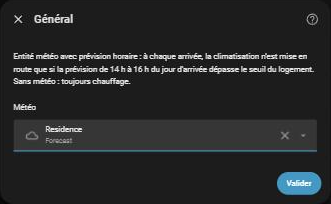
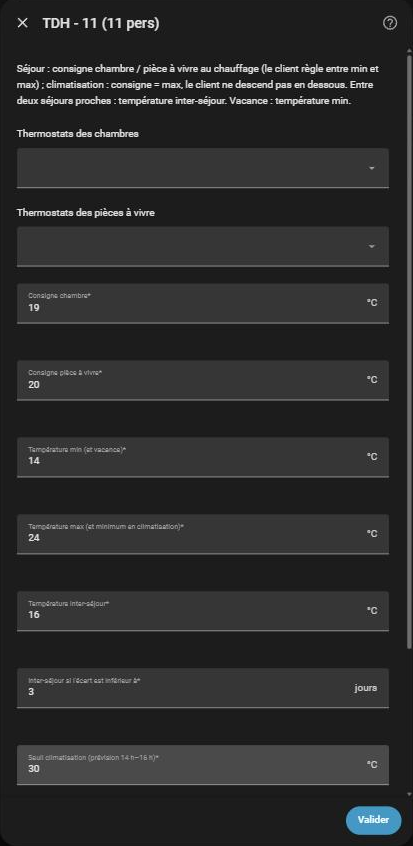

# Gestion locative pour Home Assistant

Pilote le chauffage, la climatisation et les équipements (VMC, ballon d'eau chaude, éclairage…) de logements de location saisonnière d'après les réservations de l'outil de gestion locative (location.pitap.com).

Home Assistant interroge l'outil toutes les 15 minutes : il n'a pas besoin d'être accessible depuis Internet. Aucune donnée du client (nom, coordonnées) ne transite, seulement les dates, heures et nombre de personnes.

## Installation

1. Dans HACS : ⋮ → **Dépôts personnalisés** → `https://github.com/Pitie18/ha-gestion-locative`, catégorie **Intégration**.
2. Installer **Gestion locative**, puis redémarrer Home Assistant.
3. **Paramètres → Appareils et services → Ajouter une intégration → Gestion locative**.
4. Adresse de l'outil et clé d'accès (dans l'outil : **Mon compte → Action → API externe**, « Créer une clé »).

   

5. Choisir les logements d'un bâtiment et nommer le bâtiment.

Ajoutez l'intégration **une fois par bâtiment** : un compte peut en avoir autant qu'il veut. Les logements en mandat sont proposés aussi. Le bâtiment et chaque logement deviennent un appareil :



Dans l'outil, réglez les heures de chaque logement (**Configuration du logement** → « Arrivée à partir de » / « Départ au plus tard à » ; 16:00 et 10:00 par défaut).

**Tant qu'aucun thermostat ni équipement n'est attribué, l'intégration ne commande rien** : elle affiche seulement l'occupation. Si des automatisations pilotent déjà les mêmes thermostats (hors-gel, limitation…), désactivez-les avant d'attribuer les thermostats, sinon elles se contrediront.

## Réglages

Roue dentée de l'intégration, puis choisir quoi régler, et finir par « Terminer et enregistrer » (rien n'est enregistré avant) :



- **Logements du bâtiment** : ajouter ou retirer des logements. Un logement retiré perd ses réglages et ses entités (appareil supprimé).
- **Général** : entité météo avec prévision horaire (pour la climatisation).

  

- **Le bâtiment** (communs) et **chaque logement** :
  - thermostats des chambres et des pièces à vivre ;
  - consigne chambre, consigne pièce à vivre ;
  - température min (aussi température de vacance) et max ;
  - température inter-séjour, et l'écart (en jours) en dessous duquel elle s'applique ;
  - seuil de climatisation (30 °C par défaut) ;
  - mise en route H heures avant l'arrivée ; décalage au départ (−2 = 2 h avant, +1 = 1 h après) ;
  - puis les équipements, autant que voulu, chacun avec son avance, son décalage au départ et le nombre de jours en dessous duquel il reste allumé entre deux séjours.

  

Exemple (logement de montagne, arrivée 16 h) : chambres 20 °C, pièces à vivre 22 °C, min 7 °C (hors-gel), max 23 °C, inter-séjour 12 °C si moins de 2 jours, mise en route 14 h avant (2 h du matin), départ +2 h.

## Fonctionnement

**Occupé** : séjour validé (ou clôturé) ou blocage propriétaire. Les réservations « À confirmer » et les autres blocages comptent comme vide.

**Thermostats** :

| Situation | Mode | Consigne | Réglage du client |
|---|---|---|---|
| Séjour (dès H heures avant l'arrivée), chauffage | chauffage | chambre ou pièce à vivre | entre min et max |
| Séjour, climatisation | climatisation | max | pas en dessous de la max |
| Entre deux séjours proches | chauffage | inter-séjour | libre |
| Vacance | chauffage | min | libre |

- À **chaque arrivée** (même le jour d'un départ), les thermostats repartent de la consigne.
- **Climatisation** seulement si la prévision du jour d'arrivée, à 14 h, 15 h ou 16 h, dépasse le seuil du logement. La décision est prise à la mise en route et gardée pendant le séjour. Sans météo ou sans prévision : chauffage. Jamais de climatisation hors séjour. Un thermostat sans mode froid n'est pas touché quand la climatisation est choisie.
- Le client garde la main dans les bornes ; il peut aussi éteindre. Un réglage hors bornes est ramené **une minute après le dernier changement** (attente relancée à chaque modification), pour ne pas se disputer le thermostat pendant que le client règle.

**Équipements** : en marche de « arrivée − avance » à « départ + décalage », maintenus entre deux séjours plus proches que le nombre de jours indiqué. Interrupteurs, lumières, ventilateurs, entrées booléennes, chauffe-eau : marche / arrêt. Automatisation : activée / désactivée. Script : lancé à la mise en route (rien à l'arrêt).

**Bâtiment** : occupé dès qu'un de ses logements l'est ; ses réglages s'appliquent à l'ensemble des séjours (mise en route la plus tôt, arrêt le plus tard).

**Fenêtres ouvertes** : non gérées par l'intégration ; une automatisation Home Assistant pièce par pièce s'en charge.

**Panne réseau** : le dernier planning reçu est gardé sur disque et continue de s'appliquer, même après un redémarrage. Le capteur « Dernière synchronisation » indique la date du planning utilisé (attribut `a_jour` à faux en cas de panne).

**Appareil injoignable** : la commande est retentée toutes les 5 minutes.

## Entités

Un appareil par logement et un pour le bâtiment :

- **Occupé** (oui / non) ;
- **État** : vide, préchauffage, occupé, inter-séjour ;
- **Mode prévu** : chauffage ou climatisation ;
- **Prochaine arrivée**, **Prochain départ**, **Personnes** ;
- **Suspendre** : plus aucune commande (travaux, pilotage manuel) ; à la reprise, l'état du moment est réappliqué.

## Développement

```
python -m unittest discover -s tests -v
```

Les tests n'ont pas besoin de Home Assistant : le calcul (`planning.py`) est pur, et le pilotage est testé avec un Home Assistant simulé sur un planning réel anonymisé (`tests/occupation.json`). La validation GitHub lance aussi hassfest et la vérification HACS.

API utilisée : `GET api/occupation` de l'outil (en-tête `X-Cle-Api`), décrite dans le README du dépôt de l'outil.
